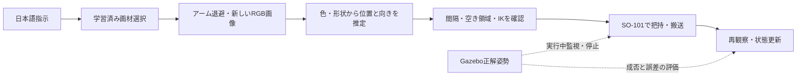

# SO-101 / ROS 2 Humble + Gazebo Fortress

現在の主アームはSO-101です。CRANE+ V2は講義環境の初期検証記録として保持します。
公式TheRobotStudioのフォロワーURDF（new calibration）とSTLを使用し、Humbleのign_ros2_controlへ接続しました。

## 自由に戻した画材を再観察する試作

現在のテーマは「自由に使って戻せる画材トレイから、必要な画材を取り出すアシスタント」。
位置・向きが変わるが、重なりがなく十分な間隔がある3点を対象にする。
消しゴムと赤・青のクレヨンは箱形状の代理物で、実物の細い画材の把持性能とは区別する。



### 起動

このディレクトリで世界を生成し、コンテナへコピーする。既存の単一画材サーバーと同時に動かさない。
カメラ描画があるため、起動時のコントローラ切替待ちを30秒へ延長している。

```sh
python3 so101/make_scattered_world.py --seed 7 --output worlds/so101_scattered.sdf --camera
docker restart pai-ros2-gazebo
docker cp so101 pai-ros2-gazebo:/workspace/so101
docker cp worlds pai-ros2-gazebo:/workspace/worlds
docker cp scripts pai-ros2-gazebo:/workspace/scripts
docker cp ../art_assistant pai-ros2-gazebo:/workspace/art_assistant
docker exec pai-ros2-gazebo chmod -R a+rwX /workspace
```

別々の端末で起動する。

```sh
docker exec -u ubuntu pai-ros2-gazebo bash /workspace/scripts/launch_scattered.bash
docker exec -u ubuntu pai-ros2-gazebo bash /workspace/scripts/launch_scattered_server.bash
```

GUIは任意で `launch_so101_gui.bash`。俯瞰カメラ画像は `/art_materials/camera`。
指示と応答のトピックは従来と同じ。画像からの取得・返却を実行する確認スクリプト：

```sh
docker exec -u ubuntu pai-ros2-gazebo bash -c 'source /opt/ros/humble/setup.bash; python3 /workspace/so101/check_scattered_commands.py'
```

- 位置はトレイ内の乱数配置。シード・形状・初期位置・向きはSDF横のJSONに保存する。
- RGBカメラは既知の俯瞰設置・内部パラメータ・一定の物体上面高さを使用する。
- 視覚はOpenCVによる色分割と幾何処理。学習済み視覚モデルではない。AIの使用箇所は日本語の画材選択。
- 細長い箱は主軸から向きを推定。正方形の消しゴムは90度ごとの等価な把持方向を矩形から推定する。
- 指示ごとに退避し、新しい画像から現在位置を取得。前回の置き場所は把持座標に使わない。
- 画像を制御入力とし、Gazebo正解姿勢は持ち上げ・保持・周辺移動の実行中監視、停止判断、成否評価に使用する。
- 返却先は空きを確認した所定の場所。ユーザーが自由に戻した後の再取得を扱うことと、ロボットの返却先が自由であることは区別する。
- 対象が見つからない・候補が一意でない・画素面積が期待範囲外なら `not_detected`。既知3点を観察できない、周辺や配置先に余裕がない場合は `blocked`。
- 画素面積だけで遮蔽を完全に検出できるわけではない。一般的な山積み・遮蔽解消、未知画材、実機への一般化は対象外。
- 複数画材の同時追加・交換はこのサーバーでは未実装。受け取り場所が埋まっていれば追加搬送を拒否する。

ユーザー返却を模した再配置（動作確認スクリプトが終了し、ロボットが退避しているときだけ実行）：

```sh
docker exec -u ubuntu pai-ros2-gazebo bash -c 'source /opt/ros/humble/setup.bash; OPENBLAS_NUM_THREADS=1 python3 /workspace/so101/emulate_user_return.py'
docker exec -u ubuntu pai-ros2-gazebo bash -c 'source /opt/ros/humble/setup.bash; python3 /workspace/so101/check_scattered_commands.py --materials 消しゴム'
```

再配置スクリプトは評価専用で、利用者が戻した後の姿勢をset_poseで設定する。
ロボットの搬送とは別の操作として記録し、タスクサーバーからは呼ばない。
物理搬送中はset_pose・物体の拘束を使用しない。
サーバーと単発搬送はコンテナ内のファイルロックで重複起動を拒否する。

### 配置を変えた評価と停止条件

`evaluate_scattered.py` は、各試行間にアームが退避・停止していることを確認してから3点を置き直す評価専用スクリプト。
動作中にはset_poseを使わない。取得ごとにシーンを再設定するため、前の取得物で受け取り位置が埋まる影響を分離できる。

```sh
docker exec -u ubuntu pai-ros2-gazebo bash -c 'source /opt/ros/humble/setup.bash; OPENBLAS_NUM_THREADS=1 python3 /workspace/so101/evaluate_scattered.py --seeds 19 31 73 --guards --restore-seed 7'
```

- 3配置×3画材の取得9試行。物理的な失敗を検出したら停止し、未実施の条件を成功扱いにしない。
- 密接配置、対象がトレイ外、受け取り場所の占有、別画材で対象を隠す4条件を確認する。
- 搬送を拒否する条件では、取得用の軌道・グリッパー指令・executing応答が発生していないことを監視する。観察用の退避は区別する。
- 新しいカメラ画像、評価用の位置、全応答、完了時間、他画材の最大XY変位を記録する。
- 失敗後はロボット状態を点検し、世界とサーバーを再起動する。評価スクリプトだけで障害状態を解除しない。
- 停止条件だけなら `--seeds --guards`。再配置だけなら `--seeds --restore-seed 7`。出力ファイルは `--output` で指定できる。

失敗した場合も残りの条件を独立に測定するホスト側ランナー：

```sh
python3 so101/run_isolated_evaluation.py
```

起動済みの評価環境で停止4条件を確認し、seed 31・73の各画材を個別に試す。
物理失敗を保存してから次の試行の世界・サーバーを再起動する。
`isolated_evaluation_manifest.json` のCOMPLETEは測定の終了を表し、全試行の成功を意味しない。

独立レビューと修正記録は `preparation/REVIEW_AND_ACTIONS.md` と `report/REVIEW_FIX_RESULTS.md`。
現行は開口を0.2radへ制限し、端部の掃引半径＋他箱の半径23mm＋3mmの余裕で分離を判断する。
全リンクの接近・退避経路を保証する汎用衝突回避ではない。
他画材の移動を実行中に監視し、5mm超過時はfaultにして測定角へのhold指令を送る。hold送信と停止確認は区別し、停止追従は確認済みとしない。
診断の `arm_final_target_error` は関節の最終目標との差。移動中の補間desiredへの追従誤差ではなく、閉鎖中の保持誤差等の切り分けに使う。

以下は旧設定での試験記録：
初期の反復評価では細い代理物を閉じる際に押し出す失敗が発生。
閉じ指令を弱める調整と既知幅からの把持位置補正を試したが、その失敗条件は改善しなかった。
これらの試験設定は主実装から戻し、以前の検証済み設定で範囲を評価する。未解決の把持失敗を成功として扱わない。
`artifacts/experimental_motion_backend_trial3.py` は失敗調査用の保存ソースで、実行時には使わない。

配置seed 19・31・73の9取得は7成功・2失敗。青の把持／配置の安定性は未解決。
停止4条件は最終版で確認。最新の集計は `artifacts/robustness_summary.json` と `report/ROBUSTNESS_RESULTS.md`。
以下は既知座標から始めた単一画材の過去のベースラインである。

## 日本語指示をROSから実行

`so101_pick.sdf`の世界とコントローラを起動した後、別端末で実行する。
既存の画材選択モデルを共有するので、初回は以下もコピーする（このディレクトリで実行）。

```sh
docker cp ../art_assistant pai-ros2-gazebo:/workspace/art_assistant
docker exec -u ubuntu pai-ros2-gazebo bash /workspace/scripts/launch_material_server.bash
```

指示は `/art_materials/command`（std_msgs/String）、応答は `/art_materials/status`（JSON文字列）。
例えば別端末から以下を送る。

```sh
docker exec -u ubuntu pai-ros2-gazebo bash -c 'source /opt/ros/humble/setup.bash; export RMW_IMPLEMENTATION=rmw_cyclonedds_cpp; ros2 topic pub --once /art_materials/command std_msgs/msg/String "{data: 消しゴムを持ってきて}"'
```

- 「消しゴムを持ってきて」：保管位置から手元へ。「消しゴムを戻して」：保管位置へ返却。
- 画材選択には既存の文字n-gram分類器（合成指示文で学習）を使用。操作判定は規則。
- 現在のGazebo世界で動かせる画材は消しゴム1個。その他の画材は `unsupported`。
- 曖昧な指示は `clarify`、否定指示は `rejected`、すでに目的位置なら `noop`。
- 実行中の追加指示は `busy` で拒否。物体位置の検証後だけ保管／手元の状態を更新。
- 失敗した場合は位置を `unknown` とし、追加の搬送を止める。世界を点検しノードを再起動する。
- 起動時は実測位置から状態を復元する。Gazeboの既知座標による判定で、画像認識ではない。
- このノードと `pick_material.py` は共通の `motion_backend.py` を使用する。同時に動かさない。
- `localhost:8080` は旧MuJoCo UI。このROSノードへは接続していない。

統合確認（実際に返却・再搬送するので、別の指令を同時に送らない）：

```sh
docker exec -u ubuntu pai-ros2-gazebo bash -c 'source /opt/ros/humble/setup.bash; python3 /workspace/so101/test_commands.py'
docker cp pai-ros2-gazebo:/workspace/artifacts/so101_commands.json ./artifacts/
```

## 画材1点の把持・搬送（確認済み）

22×22×26mm・12gの単純形状の消しゴムを、[0.18, 0, 1.013]mから
受け取り位置[0.18, -0.10]mへ搬送する。
初期状態から独立に2回実行し、両方で約62mmの持ち上げ・運搬中の保持・配置を確認。
配置誤差は約0.972mm。固定条件1種類での試作で、汎用的な成功率ではない。

手順は以下。CRANE+ V2や通常のSO-101 launchと同時に実行しない。

```sh
docker restart pai-ros2-gazebo
docker exec -u ubuntu pai-ros2-gazebo bash /workspace/scripts/launch_so101_pick.bash
```

別の端末でGUI、別の端末で動作を実行する。

```sh
docker exec -u ubuntu pai-ros2-gazebo bash /workspace/scripts/launch_so101_gui.bash
docker exec -u ubuntu pai-ros2-gazebo bash /workspace/scripts/record_so101_pick.bash
```

実行の前提として、下記起動手順の `so101/`、`scripts/`、`worlds/` をコンテナへコピーしておく。
試行をやり直す場合はコンテナ再起動から行い、世界の初期状態を再生成する。

- kinematics.py：公式URDFからFKを計算し、関節制限付き数値IKを解く。
- 手先座標：gripper_frame_linkから指の間へ12mmオフセットした作業座標。
- 下降・持ち上げ・水平搬送は、手先の直線経路上の10中間姿勢をJointTrajectoryへ送信。
- 現行の開き角は0.2rad。既知の最大22mm箱に約27.9mmの開口を確保し、端部掃引半径は約35.1mm。
- `SO101_OPEN_ANGLE`で診断時に変更可能。0.8radでは約77.1mmの張り出しとなり、新しい余裕判定では通常配置も拒否される。設定と分離距離を一体として扱う。
- 閉じる動作は接触で止まるため、閉じ角への到達を合格条件にしない。
- 成功条件：35mm以上の持ち上げ、運搬中も保持、最終XY誤差25mm以内と机上高さ。
- /model/eraser/poseをGazeboからROSへ変換し、物体位置で判定。画像認識ではない。
- 拘束による吸着・固定や、搬送中の物体座標の書き換えは使わない。

### モデルの簡略化と限界

指先2リンクの詳細な衝突メッシュを、掌・固定指・可動指の箱形状へ置換した。
公式の見た目・関節構造・質量慣性は維持。実機の接触特性やモータトルクを再現したものではない。
グリッパーは位置制御であり、力制御ではない。
画材の形状・配置は固定。日本語指示のROS接続は消しゴムの搬送・返却まで。複数画材・交換、画像認識は未実装。

### 保存した結果

- artifacts/so101_pick_summary.json：2試行の要約
- artifacts/so101_pick.json：今回の最終試行の段階別座標
- artifacts/so101_pick_success1.json：最初の成功試行
- artifacts/so101_pick_bag_info.txt：rosbag2の内容
- artifacts/so101_pick_bag_*/：指令・関節状態・物体位置・/clockの記録
- artifacts/so101_pick_trial1.json、trial2.json：調整中の失敗記録

ROS通信は講義イメージに導入済みのCyclone DDSへ統一。
Gazebo FortressのPosePublisherではpublish_model_poseに加えpublish_nested_model_poseも有効にする。

## SO-101を起動する

このディレクトリで実行します。

```sh
docker compose up -d
docker exec pai-ros2-gazebo mkdir -p /workspace/artifacts
docker cp so101 pai-ros2-gazebo:/workspace/so101
docker cp scripts pai-ros2-gazebo:/workspace/scripts
docker cp worlds pai-ros2-gazebo:/workspace/worlds
docker exec pai-ros2-gazebo chmod -R a+rwX /workspace
```

以下は別のターミナルで実行。CRANE+ V2のlaunchとは同時に起動しない。
切り替える場合は先に `docker restart pai-ros2-gazebo`。

```sh
docker exec -u ubuntu pai-ros2-gazebo bash /workspace/scripts/launch_so101.bash
docker exec -u ubuntu pai-ros2-gazebo bash /workspace/scripts/launch_so101_gui.bash
```

http://localhost:6080/ を開き「接続」を押します。

## 動作確認

```sh
docker exec -u ubuntu pai-ros2-gazebo bash -c 'source /opt/ros/humble/setup.bash; python3 /workspace/so101/check_motion.py'
docker cp pai-ros2-gazebo:/workspace/artifacts/so101_motion.json ./artifacts/so101_motion.json
```

- arm：shoulder_pan / shoulder_lift / elbow_flex / wrist_flex / wrist_roll の5関節。
- gripper：gripperの1回転関節。LeRobotの0〜100スケールではなくURDFのradを使用。
- 指令：/so101_arm_controller/joint_trajectory、/so101_gripper_controller/joint_trajectory。
- 状態：/joint_states。
- アームの目標到達、グリッパー開閉、開始姿勢への復帰を許容誤差0.015radで確認済み。
- モデルの各リンクの質量・慣性・メッシュは上流URDFに基づく。位置制御はシミュレーション用で、実機モータの忠実な再現ではない。
- 単一の消しゴムの把持・搬送は上記のとおり確認済み。複数画材と実機通信は未実装。

## モデルの出典と変更

vendor/SOURCE.jsonに上流コミットを固定。Apache-2.0のLICENSEを同梱。
https://github.com/TheRobotStudio/SO-ARM100/tree/main/Simulation/SO101

上流モデルはvendor/内にそのまま保持し、make_description.pyで以下を追加する。

- メッシュ参照をコンテナ内の絶対file URIに変更。
- worldへの固定取付（机上z=1.015m）。
- ros2_controlの位置指令・状態インターフェース。
- IgnitionROS2ControlPluginと関節のdamping/friction。
- 把持評価のため、末端2リンクの衝突メッシュを箱形状の接触モデルへ置換。

生成URDFはso101/generated.urdf。GUIはCPU描画とQSG_RENDER_LOOP=basicを使用。

---
以下はCRANE+ V2を使った講義環境の検証記録です。

# ROS 2 Humble + Gazeboへの移行

講義第4・5回と同じイメージ、CRANE+ V2、JointTrajectoryトピックを使う。
MuJoCoのXYZ直動モデルからは制御方式・可動範囲が変わるため、把持成功結果をそのまま引き継がない。

## 起動

このディレクトリで実行する。

```sh
docker compose up -d
docker exec pai-ros2-gazebo mkdir -p /workspace/artifacts
docker cp scripts pai-ros2-gazebo:/workspace/scripts
docker cp worlds pai-ros2-gazebo:/workspace/worlds
docker exec pai-ros2-gazebo chmod -R a+rwX /workspace
```

http://localhost:6080/ で「接続」を押す。
Apple Siliconでは講義資料に従いlinux/amd64を指定している。
必要な6080番だけをローカルに公開し、特権モード・ホストのフォルダ共有は使用しない。

## 講義のアームを起動

```sh
docker exec -u ubuntu -e DISPLAY=:0 pai-ros2-gazebo bash /workspace/scripts/launch_lecture.bash
```

## このMacで検証済みのローカル世界

講義のCRANE+ V2・ros2_control・MoveIt・ROSトピックをそのまま使用。
外部モデル取得への依存を避け、机・照明・床・キューブをローカルの単純形状へ置換した。
GazeboはIgnition Gazebo Fortress 6.16.0。Classic Gazeboもイメージに入っているが、この起動では使用しない。

講義の起動と同時には実行せず、コンテナ再起動後に以下を別々の端末で実行する。

```sh
docker exec -u ubuntu pai-ros2-gazebo bash /workspace/scripts/launch_local.bash
docker exec -u ubuntu pai-ros2-gazebo bash /workspace/scripts/launch_gui.bash
```

物理サーバーはGUIと分離。GUIはApple Siliconのamd64エミュレーションに合わせ、
DBusセッションとQSG_RENDER_LOOP=basic、OGRE2、ソフトウェアOpenGLを使用。
ROSの通信プロセスはubuntuユーザーにそろえる。rootで実行した際、状態データを受信できなかった。

## 関節指令と状態の動作確認

別のターミナルで実行。

```sh
docker exec -u ubuntu pai-ros2-gazebo bash -c 'source /opt/ros/humble/setup.bash; python3 /workspace/scripts/check_motion.py'
docker cp pai-ros2-gazebo:/workspace/artifacts/. ./artifacts/
```

/joint_statesを受信し、/crane_plus_arm_controller/joint_trajectoryへ小さな関節指令を送信する。
目標への追従と開始位置への復帰を、JointStateの実測値で確認する。

## 画材アシスタントの移植順序

1. 講義のアーム・Gazebo・ros2_control・状態取得を確認する。
2. 関節指令と状態をrosbag2で記録する。
3. CRANE+ V2の可動範囲に合わせた画材配置と受け取り位置を設計する。
4. 画材1点の把持・搬送をGazeboで実装し、物理状態を検証する。
5. 既存のカタログ、画材選択、確認対話、交換計画をROSノードへ接続する。
6. 12点・交換・追加・返却の評価をGazeboでやり直す。

移行中のためlocalhost:8080はMuJoCo版のまま。ROS版の搬送が確認できるまで同じものとして扱わない。
ROS版の状態はartifacts/とpreparation/ROS2_MIGRATION.mdに記録する。

## 出典

- 講義第4回 p36、38、43
- 講義第5回 PDF p10、38
- https://github.com/AI-Robot-Book-Humble/docker-ros2-desktop-ai-robot-book-humble
- https://github.com/matsuolab/physicalai_pubsub

## 実測結果

- ROS 2 Humble / Ignition Gazebo Fortress 6.16.0、CRANE+ V2起動。
- joint1へ0.2radの指令を送り、0.191radへ到達、復帰時0.0096radを確認（許容誤差0.01rad）。
- 残り3関節は開始角度を維持。
- rosbag2で指令2件、JointStateと/clockを記録。詳細はartifacts/bag_info.txt。
- 記録の再実行：`docker exec -u ubuntu pai-ros2-gazebo bash /workspace/scripts/record_check.bash`。
- Gazebo表示とRViz表示の両方を確認。表示には起動後しばらく時間がかかる場合がある。
- 画材の把持・搬送、AIの接続はまだROS版へ移植していない。

lecture_local.launch.pyは講義イメージ内のApache-2.0ライセンスのlaunchを基に、worldの参照先とサーバーのみ起動へ変更。

## ROSカメラと応答を使う連続デモ

```sh
docker exec -u ubuntu pai-ros2-gazebo bash -c 'source /opt/ros/humble/setup.bash; OPENBLAS_NUM_THREADS=1 python3 /workspace/so101/record_ros_demo.py'
docker cp pai-ros2-gazebo:/workspace/artifacts/ros_reobservation_demo.mp4 ./artifacts/
```

日本語指示・観察・実際の搬送、返却後の再配置と再取得を記録する。
カメラのシミュレーション時刻で5fpsへ再標本化し、10fpsのMP4にする2倍速。動画内に倍率と限定条件を表示する。
利用者返却を模した評価用の配置変更は、ロボットが退避・停止している間だけ実行し字幕で区別する。
提出前にはOmniCampus ID、1〜3分の長さ、失敗例と限定条件を含む最終編集・確認が必要。
